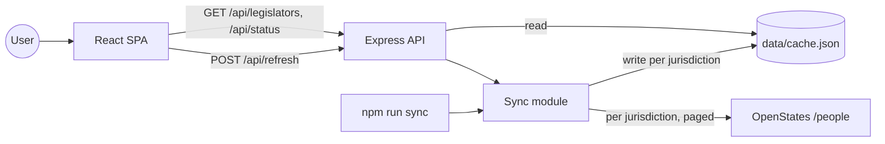

# Politician Researcher: Project Overview

> **Last verified:** 2026-11-17 · commit `5c33a70`
> Maintainers: update this file when you change structure, entry points, or setup steps.

## Purpose

A local prototype that syncs current U.S. state legislators from the [OpenStates](https://openstates.org) v3 API into a JSON cache on disk, then shows them in a filterable web table. Coverage is 52 jurisdictions (50 states, DC, Puerto Rico). Requirements are in [PRD-0001](prds/PRD-0001.md).

It deliberately does not cover Congress, governors or other executives, vacant seats, auth, deployment, or automated refresh ([ADR 0003](adr/0003-state-legislators-only-from-openstates.md), [PLAN-0001](plans/PLAN-0001.md)).

## Tech stack

| Layer    | Technology                                | Notes                                                                      |
| :------- | :---------------------------------------- | :------------------------------------------------------------------------- |
| Language | TypeScript, ESM everywhere                | [ADR 0004](adr/0004-typescript-on-both-ends.md)                            |
| Monorepo | npm workspaces (`server`, `web`)          | One root lockfile. `shared/` is not a workspace; both sides import by path |
| API      | Express 5, run with `tsx`                 | Port 3001. [ADR 0005](adr/0005-express-for-backend-api.md)                 |
| Web      | React 19 + Vite                           | Vite proxies `/api` to `localhost:3001` (`web/vite.config.ts`)             |
| Storage  | One JSON file, `data/cache.json`          | Atomic temp-file + rename. [ADR 0006](adr/0006-json-file-cache-storage.md) |
| External | OpenStates `/people` endpoint             | API key from the root `.env`, server only                                  |
| Tooling  | Prettier (root), oxlint (web only), `tsc` | No test suite, no CI                                                       |

## Repository structure

```
server/src/   index.ts (API), openstates.ts (HTTP client), sync.ts, sync-cli.ts,
              normalize.ts, cache.ts, jurisdictions.ts (the 52 codes), env.ts, probe.ts
web/src/      App.tsx (state, polling), api.ts (fetch wrappers), components/
              (Filters, LegislatorTable, StatusBar)
shared/       types.ts: server/web contract, imported by both
data/         gitignored: cache.json, probe-report.json, probe-sample.json
docs/         prds/, plans/, design/, adr/, research/, DEMO_NOTES.md
```

## Architecture and data flow



**Primary flow (refresh):**

1. The UI calls `POST /api/refresh`. The API returns `202` and starts `startSync()` in the background, or `409` if one is already running (`server/src/index.ts`).
2. `sync.ts` loops over `JURISDICTIONS`. For each one it pages through `/people` (`per_page=50`), normalizes each record, replaces that jurisdiction's rows, and writes the cache. It writes after every jurisdiction, so partial progress survives.
3. A failed jurisdiction keeps its previous rows and is marked `failed` with an error. Nothing is filled in.
4. While `sync.running` is true, the UI polls `/api/status` every 2 s, then reloads legislators when the sync ends.
5. Filtering, search, and group-by (none, party, state) run client-side over the full list.

**Rate limiting (observed, per [design doc](design/politician-researcher-prototype.md) and [DEMO_NOTES](DEMO_NOTES.md)):** about 10 requests, then HTTP 429, with no `Retry-After` headers. The sync spaces requests `SYNC_DELAY_MS` (default 7000) apart and waits 65 s after a 429. A full sync is about 200 requests, roughly 25 minutes.

**Dependency direction:** `web` and `server` both import `shared/types.ts`; neither imports the other.

## Getting started

Prerequisites: Node.js with npm (required version not declared; see Open questions) and an OpenStates API key.

```bash
npm install
cp .env.example .env        # then set OPENSTATES_API_KEY in .env
npm run sync                # one-time real-data sync, ~25 min, spends API quota
npm run dev                 # API on :3001, web on :5173
```

Open http://localhost:5173. Without a prior sync the table is empty and every jurisdiction shows `pending`. You can also use the Refresh button instead of `npm run sync`.

_Derived from `package.json`, `server/package.json`, `.env.example`, and `docs/DEMO_NOTES.md`; not executed during generation._

## Development workflow

| Task                  | Command                       | Source                   |
| :-------------------- | :---------------------------- | :----------------------- |
| Run API and web       | `npm run dev`                 | root `package.json`      |
| Full sync             | `npm run sync`                | `server/src/sync-cli.ts` |
| Probe rate limits     | `npm run probe`               | `server/src/probe.ts`    |
| Build web + typecheck | `npm run build`               | root `package.json`      |
| Typecheck server only | `npm run typecheck -w server` | `server/package.json`    |
| Lint (web only)       | `npm run lint -w web`         | `web/package.json`       |
| Format                | `npm run format`              | root `package.json`      |

There is no test suite and no CI. `sync` and `probe` need a key and network, and spend rate-limited quota. Definition of done is in [AGENTS.md](../AGENTS.md).

## Configuration and environments

| Name                 | Purpose                                          | Required | Read in                                        |
| :------------------- | :----------------------------------------------- | :------- | :--------------------------------------------- |
| `OPENSTATES_API_KEY` | OpenStates auth                                  | Yes      | `server/src/env.ts` loads the repo-root `.env` |
| `SYNC_DELAY_MS`      | Delay between OpenStates requests (default 7000) | No       | `server/src/sync.ts`                           |

`.env` and `data/` are gitignored. The key must never reach the web bundle. Local only; there are no other environments.

## Central contracts

[`shared/types.ts`](../shared/types.ts) defines everything crossing the API boundary:

- `Legislator`: `id, name, party, jurisdiction` (lowercase state code), `chamber` (`upper | lower | legislature`), `district, title`, optional `imageUrl, email, openstatesUrl`.
- `JurisdictionStatus`: per-state `ok | failed | pending`, count, `syncedAt`, `error`.
- `CacheFile`: `lastSyncedAt`, `legislators`, `jurisdictions`. This is the on-disk format.
- `SyncProgress` and `StatusResponse`: what `/api/status` returns.

| Endpoint               | Returns                                             |
| :--------------------- | :-------------------------------------------------- |
| `GET /api/health`      | `{ ok: true }`                                      |
| `GET /api/legislators` | `Legislator[]` (whole cache)                        |
| `GET /api/status`      | `StatusResponse`                                    |
| `POST /api/refresh`    | `202 { started: true }` or `409 { started: false }` |

Unhandled errors return `500 {"error": "Internal server error"}` with no detail.

## Conventions and gotchas

- **Real data only.** No mock, fixture, hand-written, or inferred legislator records. Gaps show as `pending` or `failed` jurisdictions ([ADR 0002](adr/0002-real-synced-data-only.md)). This is why there are no tests.
- **One sync at a time.** The CLI and the UI Refresh each keep an in-process lock, so they do not see each other. Do not run both at once ([DEMO_NOTES](DEMO_NOTES.md), [ADR 0006](adr/0006-json-file-cache-storage.md)).
- **Server imports use explicit `.ts` extensions** (`rewriteRelativeImportExtensions`). The web side imports without extensions.
- **Cache writes go through `writeCache`** (`server/src/cache.ts`): temp file then rename.
- **Sync is slow by design.** Do not lower `SYNC_DELAY_MS` without re-probing; a 429 costs a 65 s wait.
- **`normalize()` never invents fields.** Missing values become empty strings or `undefined` (`server/src/normalize.ts`).

## Where to go next

- [AGENTS.md](../AGENTS.md): commands, conventions, and boundaries for coding agents
- [PRD-0001](prds/PRD-0001.md), [PLAN-0001](plans/PLAN-0001.md) (including "Cuts and why")
- [Design doc](design/politician-researcher-prototype.md): components, risks, probe results
- [ADR index](adr/README.md): six accepted decisions
- [Backend framework evaluation](research/backend-framework-eval.md)
- [DEMO_NOTES](DEMO_NOTES.md): observed API behavior and known limits
- [web/README.md](../web/README.md): Vite template README

## Open questions

- **Where are executives filtered out?** `DEMO_NOTES.md` says 179 executives are dropped (7,417 kept), and `data/cache.json` holds 7,417 records with only legislative titles. But no filter exists in `server/src/normalize.ts` or `sync.ts`. Either the filtering lives elsewhere, or the cache came from earlier code. Resolve by reading `server/src/openstates.ts` history or re-syncing one jurisdiction (with maintainer approval).
- **Node version.** No `engines` field or `.nvmrc`. Ask the maintainer which version is supported.
- **oxlint.** `DEMO_NOTES.md` lists oxlint as cut, but `web/package.json` and `web/.oxlintrc.json` use it. Likely stale notes (inferred).
- **Manual verification.** DEMO_NOTES says the browser walkthrough and the spot-check against openstates.org are not yet done.
