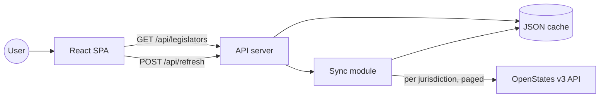

# Solution outline: Politician Researcher Prototype

> **Draft for human review. Estimates are rough.**

**Date:** 2026-11-17
**Stack:** The repo is empty and states no stack. The `stack-profile` defaults (TypeScript ESM, Vite + React, Vitest, Prettier, npm workspaces) apply, trimmed for a local prototype. NestJS, Lambda and CDK are cut because nothing is deployed. The user confirmed TypeScript on both ends.

## Summary

The user wants a local app that lists the current state legislators for the 52 U.S. jurisdictions (50 states, DC, Puerto Rico). It must show fresh data and let the user view it by party or by state. The proposed shape is a small Node/TS API that syncs OpenStates data into a local cache. A Vite + React single-page app reads that cache through one table with filters and a group-by toggle. The main risk is the OpenStates free-tier rate limit during the first sync. The cache and a visible "last updated" time are the mitigation.

## Requirements and assumptions

**Functional** (fact, from PRD-0001)

- See who the representatives are in the 52 jurisdictions.
- Data is the latest available, because it changes after elections or when someone leaves office.
- View by party or by state.

**Non-functional**

- Freshness: the user can trigger a refresh and sees when the data was last synced. (Inference: "latest" is read as on-demand, not real-time.)
- Local-running only, no deployment (fact).

**Constraints** (fact)

- Solo build, 30 minutes to a first demo.
- React or Angular SPA frontend. Backend is my choice.
- The OpenStates free-tier API key is already held by the user.
- Cuts must be explainable.

**Assumptions** (each one changes the design if wrong)

| #   | Assumption                                                                                                                               | Impact if wrong                                                                                             |
| --- | ---------------------------------------------------------------------------------------------------------------------------------------- | ----------------------------------------------------------------------------------------------------------- |
| A1  | **Confirmed by user:** data is served from a backend cache with manual refresh, not live passthrough.                                    | Live passthrough drops the cache and sync job but makes the UI slow and rate-limit-prone.                   |
| A2  | **Confirmed by user:** "representatives" means state legislators only, from OpenStates `/people`.                                        | Adding Congress needs a second source and a merge model, which does not fit in 30 minutes.                  |
| A3  | **Confirmed by user:** one table with state and party filters and a group-by toggle.                                                     | Two separate views add a by-party summary and a by-state drill-down, so UI effort roughly doubles.          |
| A4  | **Confirmed by user:** TypeScript on both ends.                                                                                          | A different backend language changes the toolchain, not the architecture.                                   |
| A5  | Inference: the OpenStates v3 `/people` endpoint filters by `jurisdiction` and pages results. Each person carries party and current role. | If paging or fields differ, the sync code and the data model change. Verify against the API docs first.     |
| A6  | Inference: the free tier allows enough requests for about 52+ jurisdiction fetches, but throttles bursts.                                | A tighter quota makes the sync slow, so it needs resume and backoff, or a pre-seeded snapshot for the demo. |
| A7  | Inference: a JSON file cache is enough for a few thousand records.                                                                       | A larger dataset or richer queries would justify SQLite.                                                    |
| A8  | Inference: the API key lives in a git-ignored `.env`, read only by the backend.                                                          | If the key is in the browser, it leaks. This is not acceptable even locally.                                |
| A9  | Inference: Puerto Rico and DC are returned as jurisdictions by OpenStates, which gives the 52.                                           | If not, the count is off and the "52" claim needs a note in the UI.                                         |

## Architecture

| Component                 | Responsibility                                                                                                                 | Interfaces                                                               | Notes         |
| ------------------------- | ------------------------------------------------------------------------------------------------------------------------------ | ------------------------------------------------------------------------ | ------------- |
| React SPA (Vite)          | Table of legislators with search, state filter, party filter and a group-by toggle. Shows "last updated" and a Refresh button. | In: `GET /api/legislators`, `GET /api/status`. Out: `POST /api/refresh`. | A3            |
| API server (Node/TS)      | Serves cached data. Triggers a sync. Holds the API key.                                                                        | HTTP/JSON to the SPA. Calls the sync module.                             | A4, A8        |
| Sync module               | Fetches `/people` per jurisdiction from OpenStates, handles paging, retries and throttling, and normalizes the records.        | OpenStates REST. Writes the cache.                                       | A5, A6        |
| Cache store               | Persists normalized records and the sync timestamp.                                                                            | Read by the API, written by sync.                                        | A7, JSON file |
| OpenStates API (external) | Source of truth for legislators.                                                                                               | HTTPS with an API key header.                                            | Free tier     |

Normalized record (inference): `id, name, party, jurisdiction (state code), chamber, district, title, imageUrl, email`. Party and state filtering and grouping run client-side on the cached list.

## Key decisions

| #   | Decision          | Options noted                                                                                | Next step                                                                                                                             |
| --- | ----------------- | -------------------------------------------------------------------------------------------- | ------------------------------------------------------------------------------------------------------------------------------------- |
| D1  | Freshness model   | Backend cache with manual refresh (user's current choice), live passthrough, static snapshot | `adr-author` to record the user's choice                                                                                              |
| D2  | Cache storage     | JSON file, SQLite                                                                            | Decided: JSON file. See [ADR 0006](../adr/0006-json-file-cache-storage.md).                                                           |
| D3  | Backend framework | Hono, Express, Fastify, NestJS                                                               | Decided: Express. See [ADR 0005](../adr/0005-express-for-backend-api.md) and the [evaluation](../research/backend-framework-eval.md). |
| D4  | Grouping location | Client-side over the full list, server-side query params                                     | Client-side while the dataset stays small.                                                                                            |
| D5  | Refresh trigger   | Manual button only, manual plus timer, startup refresh when stale                            | Manual plus a stale indicator is the smallest option.                                                                                 |

## Risks

| #   | Risk                                                                                | Likelihood | Impact | Mitigation                                                                                                 |
| --- | ----------------------------------------------------------------------------------- | ---------- | ------ | ---------------------------------------------------------------------------------------------------------- |
| R1  | Free-tier rate limit stalls or fails the initial sync.                              | High       | High   | Throttle and back off. Sync per jurisdiction and persist partial progress. Seed the cache before the demo. |
| R2  | API schema differs from the assumption, such as party shape or jurisdiction naming. | Medium     | Medium | Read the docs and fetch one sample first, then fix the normalizer.                                         |
| R3  | Stale or partial data looks like the "latest".                                      | Medium     | Medium | Show the last sync time and per-jurisdiction counts. Flag jurisdictions that failed to sync.               |
| R4  | The 30-minute budget is exceeded.                                                   | Medium     | Medium | Build in order: sync, API, table, then filters. Cut group-by and polish first.                             |
| R5  | The API key is committed or exposed.                                                | Low        | High   | `.env` is git-ignored. The key is never sent to the browser.                                               |
| R6  | Vacant seats or multi-member districts make counts look wrong.                      | Low        | Low    | Note it in the UI. Do not hide it.                                                                         |

## Staffing and effort sketch

Roles: one full-stack engineer (solo). Effort is in minutes and relative sizes because the repo has no history to calibrate against.

| Component or work item                                    | Role       | Effort range    | Assumption        |
| --------------------------------------------------------- | ---------- | --------------- | ----------------- |
| Scaffold (Vite React, Node API, `.env`)                   | Full-stack | 3 to 5 min (S)  | A4                |
| Rate-limit probe (real requests, record headers and 429s) | Full-stack | 3 to 5 min (S)  | A6, unknown quota |
| Sync module and normalizer                                | Full-stack | 8 to 12 min (M) | A5, A6            |
| API routes and cache                                      | Full-stack | 3 to 5 min (S)  | A7                |
| React table, filters and group-by                         | Full-stack | 8 to 12 min (M) | A3                |
| Refresh button, last-updated, error states                | Full-stack | 2 to 4 min (S)  | A1                |
| Initial sync run and smoke check                          | Full-stack | 2 to 5 min (S)  | A6                |

**Total:** about 29 to 48 minutes of work, **only valid under** A1 to A9, and **excluding** time lost to rate-limit waits, API surprises, tests and styling. The upper end exceeds the 30-minute budget, so the cut list below applies.

**What to cut, and why (inference):**

- Tests, beyond a manual smoke check. The demo outranks coverage at this size.
- Scheduled refresh. A manual button is enough to show freshness.
- Pagination or virtualization in the UI. A few thousand rows render fine.
- Detail pages and a by-party summary view (A3). Filtering covers the requirement.
- Auth, deployment, Docker and CI. Local only.

## Review feedback applied (2026-11-17)

- **Rate limits are unknown.** The OpenStates docs do not publish quota numbers. The first build step is a probe that makes real requests, reads any rate-limit response headers and 429 responses, and records what it finds. The sync's throttle and batch size are set from that result (R1, A6).
- **Vacant seats are deferred.** Inference, not verified: `/people` lists only people, so showing an empty seat means deriving it from seat counts. That is not cheap, and it would create data the API did not return. This conflicts with the no-generated-data rule below.
- **No generated data.** The demo shows only records that were synced from OpenStates and cached. There are no mocks, fixtures or seed data written by us. A "seeded" cache means a real earlier sync, not hand-made records.
- **Refresh is manual.** A button starts it. Auto-refresh is deferred.

## Open questions

1. Once the probe runs, what are the real rate limits, and is a full 52-jurisdiction sync practical in one sitting? (Answered by the probe, owner: engineer.)
   **Probe result (2026-11-17, observed):**
   - `/people` pages with `per_page` capped at 50 (`400 invalid per_page, must be in [1, 50]`). Responses carry `pagination.max_page` and `total_items`. This confirms A5. Fields are `party`, `current_role{title, org_classification, district}`, `jurisdiction`, `image`, `email`, `openstates_url`.
   - `dc` (14 people) and `pr` (83 people) resolve as jurisdictions.
   - Rate limit: about 10 requests then a `429` on the next one, at roughly 1 request per second. No `Retry-After` or `X-RateLimit-*` headers are returned, so the limit looks like about 10 requests per minute. Any daily cap is not known. A6 holds in part: bursts are throttled.
   - The sync therefore spaces requests about 7 s apart and waits 65 s on a 429. A full sync is about 200 requests, so roughly 25 minutes. It is practical as one background run, not as a live demo step. Run it once before the demo.
2. If a sync is partial, does the UI show per-jurisdiction status so the user can see which states are missing? (Assumed yes, per R3.)

**Resolved:** vacant seats deferred, refresh is manual, and the demo uses real synced and cached data only.

## Confidence and unknowns

- **Confidence:** Medium on architecture. The shape is small and the user confirmed A1 to A4. Low on timing, because the API's behavior and quota are unverified.
- **Biggest unknowns:** OpenStates rate limits and paging (A5, A6) are the biggest. The 30-minute estimate is the next.
- **Not covered:** detailed design, test strategy, security review beyond key handling, accessibility, operations, and any production deployment.
